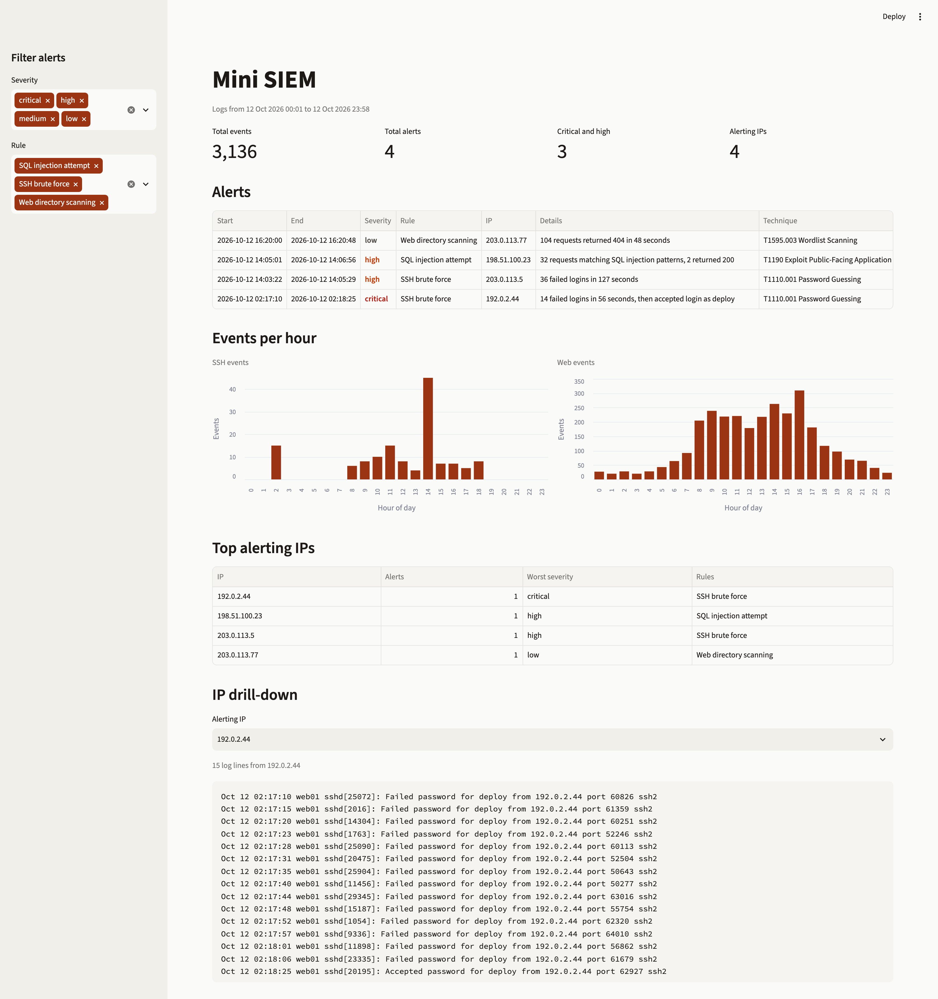

# Mini SIEM

Mini SIEM is a small intrusion detection tool I built to learn how log-based detection works. It reads an SSH auth log and a web server access log, loads them into SQLite, runs three detection rules, and tags each alert with a MITRE ATT&CK technique. The results show up in a Streamlit dashboard.

It's not meant to replace a real SIEM. I wanted something small enough that I could explain every line of it.

Live demo: https://mini-siem-xup9tgpprnay5uk8fs8kof.streamlit.app (it runs on Streamlit Community Cloud, so if it has been idle it can take about 30 seconds to wake up)

## Screenshot



## Quick start

You need Python 3.11 or newer.

```
git clone https://github.com/tahmidankur/mini-siem.git
cd mini-siem
python3 -m venv .venv
source .venv/bin/activate
pip install -r requirements.txt
python ingest.py --year 2026
streamlit run dashboard.py
```

`ingest.py` reads the two files in `sample_logs/` by default. To use your own logs, pass `--auth` and `--access`. Syslog timestamps don't include a year, so `--year` sets it. It defaults to the current year, and the sample data is from 2026.

The database is rebuilt from scratch every time `ingest.py` runs. If `siem.db` doesn't exist when the dashboard starts, the dashboard builds it from the sample logs itself, so the `ingest.py` step is optional for the sample data.

## What it detects

| Rule | ATT&CK | Logic | Severity |
|---|---|---|---|
| SSH brute force | T1110.001 Password Guessing | 5 or more failed SSH logins from one IP within 120 seconds | high, or critical if that IP later logs in successfully |
| SQL injection attempt | T1190 Exploit Public-Facing Application | URL-decoded path or query matches common SQLi patterns (`' or 1=1`, `union select`, `sleep(`, `--`, `information_schema`) | medium, or high if any matching request returned 200 |
| Web directory scanning | T1595.003 Wordlist Scanning | 20 or more requests that returned 404 from one IP within 60 seconds | low |

The thresholds are constants at the top of `detections.py`.

## How the detections work

Each rule uses SQL for filtering and sorting, then a short Python loop for the time-window logic. SQL gives back every failed login (or every 404) ordered by IP and time. A sliding window then walks over each IP's timestamps and marks any stretch where the count crosses the threshold. Overlapping windows get merged, so one attack produces one alert, not one alert per log line.

**SSH brute force.** I count failed logins per source IP. Five failures in two minutes is more than a person mistyping their password would usually produce, but low enough to catch a slow attacker. When a burst is found, I check whether the same IP had an accepted login after it started. If it did, the alert is raised to critical, because the attacker probably got in.

**SQL injection attempt.** I URL-decode each request path, lowercase it, and run it through a regex of common injection strings. All matching requests from one IP become a single alert that says how many matched. If any of them got a 200 back, the alert is high instead of medium, since a 200 suggests the server actually ran the query instead of rejecting it.

**Web directory scanning.** Tools like gobuster and dirb request hundreds of guessed paths and most of them 404. A normal visitor hits a broken link now and then, but not 20 in a minute. This one is low severity because scanning is reconnaissance, not an attack in itself.

## Sample data

The logs in `sample_logs/` are synthetic. I generated them with `generate_logs.py`, which uses a fixed random seed so the output is the same every time. They cover one day (12 October 2026): about 300 SSH lines and 3,000 web requests. Normal traffic comes from private 10.x addresses.

All the attacks come from the IP ranges reserved for documentation (192.0.2.0/24, 198.51.100.0/24 and 203.0.113.0/24), so none of them point at a real host:

- 203.0.113.5 brute-forces SSH and never gets in (high)
- 192.0.2.44 brute-forces the `deploy` account and gets in on the 15th try (critical)
- 198.51.100.23 runs sqlmap against `/products?id=`, and two requests return 200 (high)
- 203.0.113.77 runs gobuster against the site (low)

There's also a near miss that shouldn't alert. A user named priya fails her password three times and then logs in normally.

## Limitations and what I'd add next

- The SQL injection rule only knows the patterns I gave it. In the sample data, sqlmap's `1 AND 1=1` probes don't match anything, so 8 of its 40 requests go uncounted. The `--` pattern is also broad and could flag a harmless URL.
- Brute force is tracked per source IP. An attacker who spreads attempts across many IPs, or goes slower than 5 tries in 2 minutes, won't trigger it.
- The critical check accepts any successful login from that IP after the burst, with no time limit.
- The web log's timezone offset is dropped so both logs use the server's local time. That assumes both logs come from the same machine.
- One `--year` applies to the whole auth.log, so a log that crosses New Year would get the wrong dates.
- Only IPv4 addresses are parsed.
- It reads whole files in one pass. It doesn't follow a live log.

Next I'd like to add a password spraying rule (one IP trying many usernames), an allowlist for known internal scanners, and a way to follow live logs.

## Running the tests

```
pytest
```

The parser tests feed in real-looking log lines plus a malformed one. The detection tests load small hand-written event lists into an in-memory SQLite database and check that each rule fires when it should, and stays quiet on a near miss.
